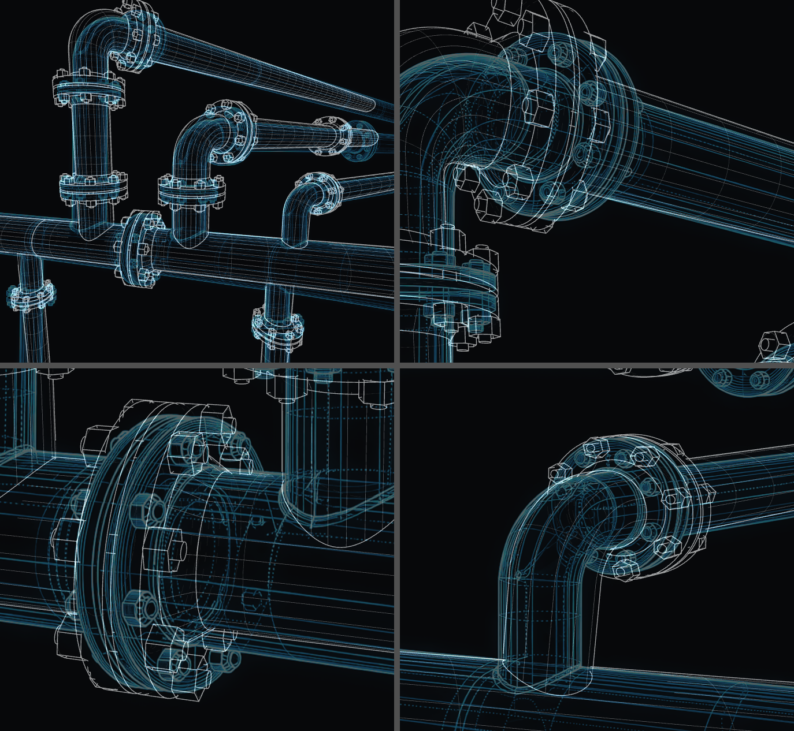
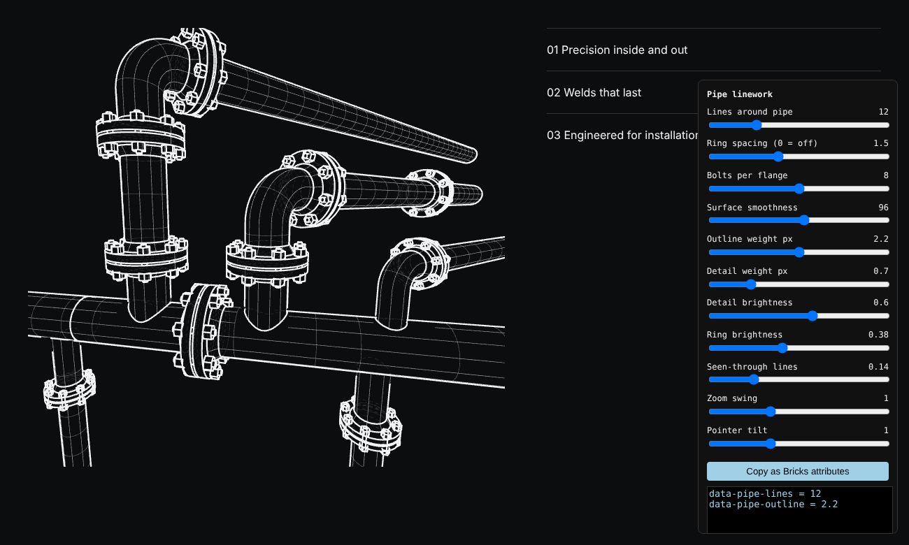

# riven-pipes-3d

Live 3D pipe linework (Three.js) for the "Our pipe" Zoom stage on the Riven home page.
It replaces the flat line-drawing image with a 3D drawing of the same pipe run, fitted to the
image's camera, so it stays crisp at every zoom and the highlight spots stay aligned.



## Install (Bricks)

Bricks > Settings > Custom code > Body (footer) scripts:

```html
<script src="https://cdn.jsdelivr.net/gh/ljoshuat/riven-pipes-3d@main/riven-pipes-3d.min.js" defer></script>
```

The script finds `.flow-illustration.zoom`, loads three.js r147 from jsDelivr when the section is near
the viewport, and keeps the original image as the fallback.

## Behaviour

- Mirrors the existing CSS hover zoom (01 / 02 / 03) through the camera's view offset.
- Hover: a slight camera swing while zooming and a pointer tilt over the drawing.
- Renders only while something moves; pauses off screen; respects `prefers-reduced-motion`.

## Fine-tuning

Open the page with `?pipes-tune`, adjust the sliders, then **Copy as Bricks attributes** and add them
to the zoom frame element: in Bricks, the Div directly above "Zoom stage" (classes `flow-illustration` and `zoom`) > Style > Attributes.

Hovering 01/02/03 highlights the matching weld ring on the 3D drawing in the site blue; the CSS arc and dot are hidden while the 3D view is active.

| Attribute | Default | |
|---|---|---|
| `data-pipe-lines` | 24 | lines around each pipe |
| `data-pipe-rings` | 1.5 | cross-section ring spacing, 0 = off |
| `data-pipe-bolts` | 8 | bolts per flange |
| `data-pipe-smooth` | 96 | surface smoothness |
| `data-pipe-outline` | 1.4 | outline weight (px) |
| `data-pipe-detail` | 0.7 | detail line weight (px) |
| `data-pipe-detail-opacity` | 0.6 | detail brightness |
| `data-pipe-ring-opacity` | 0.38 | ring brightness |
| `data-pipe-hidden` | 0.14 | dashed lines seen through pipes, 0 = off |
| `data-pipe-swing` | 1 | camera swing while zooming, 0 = off |
| `data-pipe-tilt` | 1 | pointer tilt, 0 = off |
| `data-pipe-color` | | line colour; blank = section text colour |
| `data-pipe-highlight` | 3 | weld highlight width (px), 0 = off |
| `data-pipe-highlight-color` | | highlight colour; blank = site blue (`--zoom-accent` / `--color-blue`) |
| `data-pipe-rest-zoom` | 1 | resting zoom |
| `data-pipe-rest-x` / `data-pipe-rest-y` | 0.547 / 0.5 | resting focus point (0–1) |
| `data-pipe-zoom1` / `zoom2` / `zoom3` | 3.2 / 3.84 / 3.4 | how far each 01/02/03 hover zooms in |
| `data-pipe-zoom-time` | 0.9 | zoom duration (seconds) |



## Releasing

Edit `src/`, run `python3 build.py`, commit and push to `main`. The site loads `@main`, and the
"Refresh jsDelivr cache" GitHub Action purges jsDelivr on every push, so changes go live in a minute or two
with no edit in Bricks. Visitors' browsers may keep the previous copy for up to about 12 hours.

To freeze a known-good version instead, point the Bricks line at a commit ID or tag
(`@<commit>` / `@v1.2.0`).
